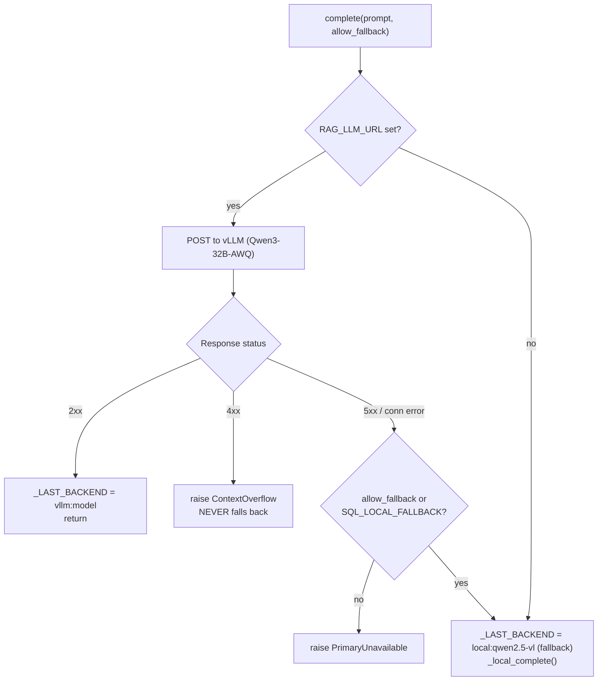

# OCR Extraction & RAG Subsystem — Architecture Overview

**Scope:** `D:\OCRproject\backend` (OCR pipeline) and `D:\OCRproject\backend\rag` (RAG subsystem)
**Verified against:** direct reading of current source files, line numbers as of 2026-08-07
**Companion diagrams:** `/diagrams/*.drawio` — open at [app.diagrams.net](https://app.diagrams.net) → File → Open From → Device. Mermaid previews of the same diagrams are embedded inline below for quick reference.

---

## 1. How to read this document

This is a consolidated technical map of two systems that share one codebase:

1. **The OCR pipeline** (`backend/*.py`) — turns a PDF/image into page text, with a dedicated geometry-grounded path for tables that avoids the classic VLM "column shift" failure.
2. **The RAG subsystem** (`backend/rag/*.py`) — ingests OCR output into Postgres/pgvector and answers questions over it via two retrieval lanes (prose + tables), with a token-budgeted evidence assembler and an aggregate-safety guard replacing a retired text-to-SQL lane.

Four draw.io diagrams accompany this document:

| # | File | Covers |
|---|------|--------|
| 1 | `diagrams/01-system-flow.drawio` | End-to-end: upload → OCR → ingest → DB → query → answer |
| 2 | `diagrams/02-ocr-structured-page.drawio` | One page's journey through `_process_page_structured` |
| 3 | `diagrams/03-table-extractor-geometry.drawio` | `table_extractor.py`'s per-table geometry pipeline |
| 4 | `diagrams/04-rag-retrieval-synthesis.drawio` | `router` → lanes → `prompt_budget` → `aggregate_guard` → `llm_client` → `synthesize` |

---

## 2. System overview

### 2.1 Design thesis

The whole system is built around one recurring engineering pattern, stated explicitly in multiple source comments: **degrade visibly, never silently.** Every fallback path — TATR unavailable, structured extraction failure, CUDA OOM, an LLM backend switch, a dropped table, an unanswerable aggregate — is caught, logged, and *surfaced to the caller or the user*, rather than absorbed into a response that looks identical to the healthy case. This shows up as a named pattern at nearly every layer (see §6, Design Philosophy).

### 2.2 High-level flow

```mermaid
flowchart TD
    A["Client: WebSocket upload_start + chunks"] --> B["server_with_task_management.py<br/>websocket_upload — reassemble chunks,<br/>write temp_&#123;session&#125;_uploaded.pdf"]
    B --> C["stream_ocr_bytes() (ocr_olm.py)<br/>async generator, page-by-page"]
    C --> D["Dual-model dispatch<br/>ThreadPoolExecutor(2): even page → Model 1, odd → Model 2"]
    D --> E["_ocr_page(img, worker_id)<br/>STRUCTURED_TABLES toggle"]
    E -- "STRUCTURED_TABLES=0" --> F["Legacy: _run_enhanced_ocr whole page"]
    E -- "STRUCTURED_TABLES=1 (default)" --> G["Structured: _process_page_structured<br/>(TATR + table_extractor)"]
    F --> H["Per-page _rag payload<br/>&#123; prose, structured, page_tables &#125;"]
    G --> H
    H --> I["Popped from lang_info before sending to browser"]
    I --> J["RAG_INGEST_ENABLED=1 ?<br/>ingest_document(file_bytes, filename, doc_rag_pages)"]
    J --> K["Postgres + pgvector<br/>documents / table_cells / prose_chunks / page_tables / figures<br/>RLS via rag.doc_ids GUC"]
    K -.-> L["User question (RAG query)"]
    L --> M["router.route(question) → lane"]
    M --> N["prose_search.search()"]
    M --> O["table_search.search()"]
    N -.->|"page pairs"| O
    N --> P["prompt_budget.assemble_evidence()"]
    O --> P
    P --> Q["aggregate_guard.classify()"]
    Q --> R["llm_client.complete()<br/>vLLM or local fallback"]
    R --> S["synthesize.answer()<br/>answer + citations + warnings"]
```



### 2.3 Repository layout referenced in this report

```
backend/
  ocr_olm.py                 entry point, dual-model loader, structured/legacy dispatch
  ocr_paths.py                MODELS_DIR / DATA_DIR / TEMP_DIR resolution, hf_snapshot()
  ocr_tatr.py                 TableTransformerParser (detection + structure models)
  table_extractor.py          geometry engine (2048 lines) — the column-shift fix
  server_with_task_management.py   FastAPI app, WebSocket + batch upload, task lifecycle
  task_manager.py             session/task state machine
  local_proc/renderpdf.py     poppler-based PDF→PNG fallback renderer
  rag/
    schema.sql                 Postgres/pgvector schema + RLS
    ingest.py                  load one OCR'd document into the KB
    db.py                      connection/DSN, RLS GUC plumbing
    prose_search.py            semantic + FTS lane over prose_chunks
    table_search.py            semantic + FTS lane over page_tables (+ page-expansion)
    embeddings.py               BAAI/bge-m3 embedder (CPU by default)
    llm_client.py                vLLM / local Qwen2.5-VL abstraction
    prompt_budget.py            token-budgeted evidence assembly (NEW)
    aggregate_guard.py          detect/refuse ungroundable aggregates (NEW)
    synthesize.py                answer() orchestration + trust boundary
    router.py                    lane selection (RAG_LANES env)
    figures.py                   embedded-figure extraction
    backfill_pdf_store.py       recover original PDF bytes by hash
    backfill_page_tables.py     recover pre-existing table HTML
D:\OCR-quarantine\backend\rag\
    text_to_sql.py, eval_sql.py   RETIRED — kept for reference, not imported
```

---

## 3. OCR Pipeline

### 3.1 Entry point and path resolution (`ocr_paths.py`, `ocr_olm.py`)

Model weights and runtime data live **outside the repo** so the repo stays copyable:

| Var | Purpose | Default |
|---|---|---|
| `OCR_MODELS_DIR` | read-only weights | `<repo_parent>/OCR-models` |
| `OCR_DATA_DIR` | writable runtime | `<repo_parent>/OCR-data` |

- `MODELS_DIR` resolution order: env var → sibling `OCR-models` → legacy in-repo `backend/models` (loud warning) → future `FileNotFoundError` (`ocr_paths.py:60-75`).
- `DATA_DIR` has **no legacy fallback**, deliberately — a silent write-fallback would split the corpus/store in two with no error (`ocr_paths.py:78-84`).
- `hf_snapshot(repo_id)` resolves the local HF cache path **without a hardcoded sha**: reads `refs/main`, else falls back to "exactly one directory under snapshots/". Multiple snapshot dirs with no usable `refs/main` → refuses to guess by newest-mtime, because that "looks helpful and is the worst option available" — it would silently load a different model revision with no error (`ocr_paths.py:99-144`).
- olmOCR-2 ships weights only, no tokenizer — the processor is loaded from the base `Qwen/Qwen2.5-VL-7B-Instruct` repo instead (`ocr_olm.py:62-64`).
- **Path resolution happens at import time**, not lazily: `server_with_task_management.py` imports `ocr_olm` at module scope, so a bad path crashes the process before it binds `:8000` — a loud, diagnosable failure rather than a `/health` endpoint that silently fails on first upload (`ocr_olm.py:71-75`).

### 3.2 Dual-model architecture

Two independent copies of the same VLM run concurrently for throughput — "cheap horizontal scaling":

- **Model 1** (always loaded): `device_map="auto"` — accelerate places layers across available GPU/CPU memory.
- **Model 2** (dual mode only): tries GPU 1 first, falls back to sharing GPU 0, then CPU. If requested before Model 1 exists, recursively loads Model 1 first.
- Both load `torch.bfloat16` on CUDA / `float32` on CPU, `local_files_only=True` (never touches the HF hub).
- Routing: `worker_id % 2 == 0` → Model 1, `worker_id % 2 == 1` → Model 2.
- **Fast path**: if already loaded, return without taking the global lock (avoids contention once warm).
- **Slow path**: double-checked locking under `_LOAD_LOCK`.
- A `threading.Lock` per model is held around every `model.generate()` call — this is what makes concurrent page processing safe: two threads can prep inputs concurrently, but only one `generate()` runs per model at a time (prevents KV-cache corruption).
- In `_stream_pdf_enhanced`, dual mode with >1 selected page eagerly preloads both models, then dispatches pages to `ThreadPoolExecutor(max_workers=2)`, alternating `worker_id = (page_num - 1) % max_workers` — even pages → Model 1, odd → Model 2. Single mode: `max_workers=1`, Model 1 only.

### 3.3 The two OCR paths — `STRUCTURED_TABLES` toggle

```python
STRUCTURED_TABLES = os.getenv("STRUCTURED_TABLES", "1").lower() not in ("0", "false", "no")
RENDER_LONGEST_DIM = int(os.getenv("RENDER_DIM", "2200" if STRUCTURED_TABLES else "1288"))
```

Default **ON**. At 1288px, "crops are small and the model hallucinates decimal points ('-112' → '-11.2') and garbles headers" — confirmed independently in `documentation/TABLE_EXTRACTION.md:195`, which says *"Do not lower it."*

Single dispatch point:

```python
def _ocr_page(img, prompt_kind="document", worker_id=0):
    if STRUCTURED_TABLES:
        return _process_page_structured(img, worker_id=worker_id)
    return _run_enhanced_ocr(img, _get_format_preserving_prompt(prompt_kind), worker_id=worker_id)
```

**Legacy path** (`STRUCTURED_TABLES=0`): one `_run_enhanced_ocr` call per page, VLM emits strict Markdown tables inline. No TATR, no masking, no geometry — whatever the VLM produces is final.

### 3.4 Structured page path — `_process_page_structured` walkthrough

```mermaid
flowchart TD
    A["Page image rendered<br/>2200px longest edge"] --> B["table_extractor.extract_page_html(img)<br/>TATR detect → merge → pad → plausibility guard"]
    B -- "import failed" --> B1["tables=[] boxes=[] structured=[]"]
    B --> C{"Any tables detected?"}
    B1 --> C
    C -- "no" --> D["Whole page read: _run_enhanced_ocr<br/>format-preserving prompt (same as legacy)"]
    D --> E["harvest_inline_tables(text)<br/>pulls native &lt;table&gt; HTML, source='prose_html'"]
    C -- "yes" --> F["_mask_table_regions → white-out boxes<br/>_downscale_for_prose → 1288px"]
    F --> G["_run_enhanced_ocr(prose_img, prose-only prompt)"]
    G --> H["_strip_and_splice_tables(prose, tables)<br/>safety net: regex-strip stray table, splice geometry tables in"]
    E --> I["_rag = &#123; prose, structured, page_tables &#125;"]
    H --> I
    I --> J["Popped by callers before sending to frontend"]
```



Key behaviors:

- `extract_page_html` **never raises** out of this call — guarded import, empty-shape fallback on any exception.
- **No-table branch**: page reads exactly like the legacy path, but `harvest_inline_tables` still recovers any `<table>` the VLM natively emitted, tagged `source="prose_html"`. On this corpus, some forms have zero TATR-detected structured cells yet dozens of tables recovered this way — this fallback harvest is what keeps those pages' tables in the knowledge base at all.
- **Table-present branch**: *masking*, not prompting, is what stops re-transcription — "Asking the model to 'skip the table' does not work... Removing the table from the image is the only reliable way: what it cannot see, it cannot transcribe." This also guarantees the prose pass can never duplicate or contradict the geometric table.
- `_strip_and_splice_tables` is a **safety net, not the primary mechanism** — masking already stops most re-transcription, but the model can still occasionally emit a stray table.
- The `_rag` payload's three fields serve three different consumers: `prose` → BM25/semantic RAG lane; `structured` → per-cell numeric DB unpivot; `page_tables` → the HTML-in-context RAG lane (with layout the structured unpivot cannot represent).

### 3.5 TATR (Table Transformer) — `ocr_tatr.py`

A thread-safe singleton loading **two separate checkpoints** from local weights only (never the HF hub):

- **Structure recognition** — detects rows/columns/headers/spanning cells within a known table crop.
- **Table detection** — finds table bounding boxes on a full page.

**SizeDict compatibility fix**: newer `transformers` wraps `.size` in a `SizeDict` rather than a plain dict, breaking the original preprocessor-normalization guard two ways (`isinstance(size, dict)` is `False`; iterating yields tuples, not a key-set match). The failure was silent-looking but total — every `recognize_structure()` call died inside DETR's `resize()`, but that exception was swallowed upstream and logged as "TATR unavailable," which reads like a missing-weights problem rather than an API-shape mismatch. Fix: read through both container shapes, compare by value not container type.

**EasyOCR fallback** (`extract_table_to_json`) is effectively **dead code** kept for future re-activation — the live pipeline uses TATR purely for geometry and reads cell text with the VLM instead. Its `model_storage_directory` guard pre-fixes a currently-unreachable problem (EasyOCR would otherwise download ~100MB of weights outside `OCR_MODELS_DIR`).

### 3.6 `table_extractor.py` — the geometry engine (2048 lines)

**Mission** (stated in the module docstring): fix the "column shift" failure of the whole-page VLM markdown path — *"on dense, ruled, handwritten forms the VLM drops the occasional blank cell and every later value slides one column left."*

Five-step approach: detect tables (TATR) → learn true column layout (including repeated side-by-side blocks) → read each block under a fixed known column count → repair every row to that width → normalize repeated blocks into one table.

```mermaid
flowchart TD
    A["detect_tables(threshold=0.5)"] --> B["_merge_stacked_boxes<br/>merge header/body splits & dupes"]
    B --> C["Pad boxes: 20px sides, 80px/15% bottom"]
    C --> D{"_is_plausible_table<br/>≥2 cols, ≥2 rows, ≤25% long cells"}
    D -- fail --> Z["Excluded from boxes<br/>(prose pass won't mask it)"]
    D -- pass --> E["Per box: _extract_table_crop"]
    E --> F["TATR structure pass (0.6, retry 0.2)"]
    F --> G["Drop edge slivers → drop detached trailing rows"]
    G --> H["Trim bottom padding to last real row"]
    H --> I["VLM: _detect_groups_and_headers<br/>(not cached — skew varies per page)"]
    I --> J["k = round(struct_cols / groups)<br/>geometry-derived, VLM count is fallback"]
    J --> K["_split_bands at true column boundaries"]
    K --> L["_read_header_robust<br/>retries ×3, keeps richest"]
    K --> M["_read_bands_batched<br/>one batched generate() over all bands"]
    M --> N{"Column count ignored<br/>in a band? (>50% rows wrong)"}
    N -- yes --> O{"≥2 ruled lines?"}
    O -- yes --> P["_read_cells_geometric<br/>per-cell crop, ink-fraction blank detection"]
    O -- no --> Q["Skip escalation<br/>(handwritten: per-cell crops = junk)"]
    N -- no --> R["_structured_quality_ok gate"]
    L --> R
    P --> R
    Q --> R
    R --> S{"Grid looks column-merged?<br/>(>6% multi-number cells)"}
    S -- yes --> T["Try _geometry_single_block (groups=1)<br/>and _vlm_structured_table (unconstrained)<br/>cleaner grid wins"]
    S -- no --> U["Assembly"]
    T --> U["_blocks_to_wide_html (display)<br/>_blocks_to_long_rows (DB unpivot + trust flag)"]
    U --> V["Return &#123; tables, boxes, structured &#125;<br/>never raises"]
```



Notable decisions:

- **Detection threshold 0.5** was chosen after a documented sweep: 0.5 missed faint 1988-scan tables entirely; 0.4 recovered them without false positives on a reference form; 0.2 was too low (a good form started splitting into 2 tables).
- **Plausibility guard is content-based, not score-based** — detection score alone can't separate real tables from prose (a numbered list once scored 0.83, higher than a genuine handwritten form at 0.58). The discriminator is cell content: short tokens vs. sentences.
- **Group/header detection is deliberately not cached** across pages of the same form — measured skew shifts column centers several percent per page, so a geometry-keyed cache never hits and a looser key risks applying one form's headers to another.
- **Batched band reading**: bands are independent, so one batched `generate()` call avoids paying prefill/decode launch cost G times. Token budget scales with `expected_rows * k * 14 + 256` (clamped [2048, 12000]) — a flat 2048 budget was measured to silently truncate a 38-row table down to 32 rows.
- **HTML over pipe-delimited output in prompts**, despite pipes being ~4x cheaper to decode: two documented pipe failures — bare pipes silently dropped blank cells (shifting every later value left, exactly the bug this extractor exists to prevent), and an empty-placeholder fix made the model swallow real `-` marks and once an entire band.
- **Cell-level escalation** only triggers on ruled-line printed reports; handwritten scans with no detectable rules are explicitly excluded (per-cell crops there came back as junk).
- **`reconcile_doc_headers`**: a cross-page consistency pass, majority-votes column headers across ≥3 pages sharing a column count, correcting an outlier page's misread header without ever homogenizing genuinely different tables.
- **`expand_table_for_prompt`**: rewrites HTML so every row has exactly one `<td>` per column, for LLM consumption only — the raw HTML with real rowspan/colspan is untouched in storage. This is the fix for a documented "Yp/Pv" column-shift bug where a 14B model, asked for a value on a rowspan-covered row, twice guessed wrong in opposite directions.

### 3.7 Rendering — `local_proc/renderpdf.py`

Fallback renderer used only when olmocr's own renderer isn't importable. Wraps poppler's `pdfinfo`/`pdftoppm` via subprocess. DPI is derived per-page from the page's actual physical size (`dpi = resolution * 72 / longest_dim_pts`, floored at 50) so a legal-size vs letter-size page renders to the same final pixel size. On any exception, returns a **pink 800×1000 placeholder PNG** — a detectable failure signal rather than a crash.

### 3.8 Server integration — `server_with_task_management.py`

- `task_manager` is a process-global singleton; each session has a UUID, each upload a `TaskInfo`, cancelling any prior task for the session by default.
- **WebSocket handler** (`websocket_upload`) is the live streaming path — page-by-page, not batch-then-send. A 20-second keep-alive task holds the connection open during long GPU inference.
- The RAG payload is popped from each page result **before** forwarding to the browser, and OCR text is pre-saved to a per-page temp file immediately, so the export endpoint never 404s while later pages are still processing.
- **Ingestion ordering matters**: RAG ingestion happens immediately after the OCR loop finishes, *before* the (best-effort) client-facing re-streaming of finalized pages — because a `WebSocketDisconnect` (tab navigated away) previously skipped ingestion entirely, silently losing a fully-OCR'd document from the knowledge base.
- `is_safe_session_id` (regex `^[A-Za-z0-9_-]{1,64}$`) guards every filesystem path built from a session ID against path traversal.
- **Batch upload** (`POST /upload/`) is the non-streaming alternative; a documented fix ensures it also lifts the `rag` key for DB ingestion — previously the batch path silently returned 0 cells and the integrity gate marked multi-page docs "failed."

---

## 4. RAG Subsystem

### 4.1 Schema (`rag/schema.sql`)

| Table | Role |
|---|---|
| `documents` | one row per ingested doc; `content_hash` (SHA-256) is the idempotency key; `status` ∈ `ingesting/ready/failed` |
| `table_cells` | EAV cell store — one row per extracted cell, `block_index/row_index/col_index` preserve exact paper provenance; **still in use**, not dead, for the Corpus editor and the numeric-cell Maker tool |
| `prose_chunks` | semantic lane store, `vector(1024)` HNSW cosine index |
| `page_tables` | **HTML-in-context lane** — raw `<table>` with rowspan/colspan/`<br>` preserved; `digest` (not `html`) is what's embedded |
| `figures` | metadata-only, content-addressed `image_ref` into `figure_store/` |
| `cell_rows` (view) | collapses `table_cells` back to one logical row; `security_invoker=true` so RLS applies through it |

**Row-Level Security**: the app sets a per-connection GUC `rag.doc_ids` before running a query; every table's `SELECT` policy checks membership against that comma-separated list, or allows everything if unset (corpus-wide default). Only the non-superuser `ocr_ro` role is subject to it — the ingestion role `ocr` is a superuser and always bypasses RLS. `page_tables`' RLS policy is explicit defence-in-depth since `table_search.py` also applies its own `doc_ids` filter directly.

**Why `page_tables` is not derivable from `table_cells`**: body rowspans are filtered out before `spans` is built, `blocks` is a dense grid by construction, and `<br>` multi-values never reach it. Also a density argument: `table_extractor`'s wide-HTML render carries ~77 chars of inline CSS per `<td>` — a 5x token regression versus the raw HTML.

**Why `digest`, never `html`, is embedded**: markup tokens dominate a bge-m3 vector, and HTML runs ~1.7 chars/token vs ~3.9 for prose — a large table would blow past the embedder's useful window.

### 4.2 Ingest — `rag/ingest.py`

Contract, stated in the module docstring:

> **Idempotency** — SHA-256(bytes) is the content_hash; re-uploading REPLACES (cascade delete, then insert) so aggregates never silently double.
> **Atomicity** — insert under `status='ingesting'`, flip to `'ready'`, commit; a document is fully queryable or invisible, never half.
> **Never fatal** — any failure raises to the caller, which logs and drops it; OCR delivery to the user is unaffected.

```mermaid
flowchart TD
    A["ingest_document(doc_bytes, filename, doc_rag_pages)"] --> B["reconcile_doc_headers across pages<br/>(best-effort)"]
    B --> C["content_hash = sha256(doc_bytes)"]
    C --> D["Write to PDF_STORE_DIR/&#123;hash&#125;.&#123;ext&#125;<br/>(best-effort, non-fatal)"]
    D --> E["Extract figures (best-effort)"]
    E --> F["BEGIN transaction"]
    F --> G["DELETE FROM documents WHERE content_hash=... (CASCADE)"]
    G --> H["INSERT documents status='ingesting' RETURNING doc_id"]
    H --> I["Build per-page rows: table_rows, cell_rows, prose_rows"]
    I --> J["Bulk insert table_cells, prose_chunks, page_tables, figures"]
    J --> K{"Integrity gate:<br/>multi-page doc with 0 cells/prose/figures?"}
    K -- yes --> L["status='failed'"]
    K -- no --> M["status='ready', COMMIT"]
    F -.->|"any exception"| N["ROLLBACK, re-raise"]
```



- **Integrity gate** cites a real incident: an 81-page document that produced 0 output previously flipped to `'ready'` silently, leaving an invisible empty document in the corpus. A 1-page upload is exempt (genuinely may have no extractable content).
- **Embedding is best-effort at ingest, with backfill**: both prose and table-digest embedding try inline (so the doc is searchable the moment it's `'ready'`), falling back to `NULL` embeddings if the embedder is unavailable — `prose_search.backfill()` / `table_search.backfill()` pick those up later.

### 4.3 Two retrieval lanes

**`prose_search.py`** — deliberately boring: chunk → embed → HNSW cosine top-k. Answers "what does this field say," never tabular content.

- `available()` (DB reachable) vs `semantic_available()` (DB + cached embedder) are separate gates; `search()` additionally checks `_has_embeddings()` since an all-NULL table would otherwise silently return zero hits.
- **Keyword fallback**, three passes in order: `websearch_to_tsquery` (phrases/OR) → an **OR-of-terms** pass (extracts content words, joins with `|`) → `ILIKE` last resort. The OR pass is what makes natural-language questions work at all — `websearch_to_tsquery` ANDs every term, so a 5-word question normally matches nothing.

**`table_search.py`** — an explicit structural twin of `prose_search.py`, same availability/degradation shape, over `page_tables`. Key differences:

- `k` defaults to **4**, deliberately small — one real table can be ~1,500 tokens of a ~6,200-token budget; retrieving 10 would guarantee drops.
- Searches `digest`, never `html` (same rationale as embedding).
- Retrieval here is pure pgvector/Postgres — "keeps working with vLLM down; only narration needs the LLM."
- **Page-expansion union**: pages surfaced by the prose lane's hits are unioned in (score=0.0, `match="page_expansion"`) if not already present — because digest search alone misses context-phrased questions that match the surrounding page strongly but the table's own digest weakly, and vice versa.

### 4.4 `embeddings.py` — BAAI/bge-m3

Runs on **CPU by default, deliberately**: the GPU is fully committed to vLLM + OCR VLMs, and embedding volume is tiny.

- `available()` is **cache-aware, not import-only** — it used to return `True` on the import alone, letting a live `snapshot_download()` block the upload WebSocket handler indefinitely on a slow link. Now it checks a local cache hit first; multi-GB models are never fetched inside a request path.
- Two cache-resolution bugs fixed: (1) bge-m3 ships a ~2.3GB unused `onnx/` copy that a naive `local_files_only=True` demands anyway — fixed with `ignore_patterns`; (2) a snapshot dir can exist with only configs while weights are an unfinished `.incomplete` blob — fixed by explicitly checking for `model.safetensors`/`pytorch_model.bin`.
- Always resolves to the on-disk snapshot path before loading — `local_files_only=True` alone isn't sufficient and a plain hub call can hit a stale cached token with a 401.

### 4.5 `llm_client.py` — two-backend abstraction



- **`ContextOverflow`** (4xx) never falls back, deliberately: the local model has a ~32k window and would silently accept the same oversized prompt and answer it, worse — while `backend_name()` would still report `vllm:<model>` because the server is in fact reachable. That would be "the most dangerous kind of silent failure in this codebase": a materially worse answer, attributed to the wrong model, with nothing but a server log line.
- **`last_backend()`** (thread-local, set on every actual completion path) is preferred over `backend_name()` (purely inferential — re-reads env vars, pings `/models`) for anything shown to a user, closing exactly this gap.

### 4.6 `prompt_budget.py` — token-budgeted evidence assembly (NEW)

**Why it exists**: HTML tables are far denser than prose in tokens (measured: ~1.73 chars/token for HTML vs ~3.91 for prose on real data) — a char-based allocator sized on "~4 chars/token" intuition would overflow by roughly 2x.

Three contracts, in priority order:
1. **Never truncate a table mid-tag** — a decapitated table is worse than none; the model reads a half-written `<td>` as a value with full confidence.
2. **Never exceed** `max_model_len - output_reserve - safety_margin`.
3. **Whatever is dropped is reported** — omitted must never be indistinguishable from nonexistent.

Mechanics:
- **Real token counts** via the vLLM `/tokenize` endpoint (note: sits at server root, not under `/v1`); falls back to a deliberately *pessimistic* per-kind estimate (`_CPT_HTML=1.5`, `_CPT_TEXT=3.0` — below the measured chars/token, so the fallback over-counts, never under-counts) if the probe fails.
- **Allocation order: tables first** (all-or-nothing, `expand_table_for_prompt`-rectangularized before costing), **prose fills the remainder** (clippable mid-string since it "has no structure to corrupt").
- **`strip_tables()`** removes `<table>` blocks from prose excerpts before packing — a table already shown whole in the tables block would otherwise also appear decapitated in a prose excerpt, wasting budget and inviting the model to treat the truncated copy as a conflicting second source.
- **Final recount-and-shed**: per-part token counts don't include joins and tokenizers aren't additive across concatenation, so the module re-tokenizes the fully-assembled string and, if still over limit, sheds whole tables (never partial) starting from the lowest-priority one added last.

### 4.7 `aggregate_guard.py` — making the SQL-removal cost visible (NEW)

**Why it exists**: the retired SQL lane could compute `average(...)` exactly, in the database. The HTML-in-context lane cannot — at ~1.7 chars/token, 147 rows don't fit an 8k window, and even when they do, the model does unreliable mental arithmetic over a table. *"The failure this module prevents is not 'wrong average.' It is 'wrong average, stated in exactly the same tone as a correct lookup.'"*

A tempting alternative — falling back to a deterministic `table_cells`-based aggregate — was explicitly rejected: it would only work for the ~1/3 of documents with structured cells, answering some aggregates and refusing others with no user-visible reason, "exactly the silent inconsistency this module exists to prevent."

Four verdicts, computed purely from the question text and the budget report (never asked of the model):

| Verdict | Trigger | Behavior |
|---|---|---|
| `not_aggregate` | no aggregate keyword match | no note, no warning |
| `answerable` | exactly 1 table, ≤25 rows (deliberately low threshold) | model may compute, must show the values used; still labeled "not a database" |
| `partial` | budget report shows dropped/malformed/clipped evidence | prompt explicitly forbids computing; user warned the figure would be from a subset |
| `unsupported` | no table at all, or too many rows/tables | refuses outright, points at `/rag/corpus-tables` for a real aggregate |

### 4.8 `synthesize.py` — the trust boundary

> "Tables are shown to the model as the source's own HTML, layout intact... The model READS values out of them; it is not asked to calculate. `aggregate_guard` enforces that distinction. Provenance and data-quality warnings are computed IN CODE from the database and the budget report, not generated by the model — a model that can forget to cite can also forget to warn."

`answer()` pipeline: `router.route()` → `prose_search` (+ `table_search` fed the prose hits' pages) → `prompt_budget.assemble_evidence()` → `aggregate_guard.classify()` (its `prompt_note` appended to evidence) → `llm_client.complete(max_tokens=prompt_budget.OUTPUT_RESERVE)` → response.

- `ContextOverflow` is caught **only at this top level** — never silently absorbed — and replaced with an explicit "this is a bug in the evidence budget" message plus a warning citing exact token counts.
- Citations are the **union** of prose hits and `report["included"]` tables (what actually survived budget shedding) — previously only prose hits produced citations, so a table-only answer was uncited.
- `_quality_warnings()` was **rewritten off the old `used_sql` gate**, which meant a prose-only answer emitted zero warnings — silently dropping the "these are unverified OCR values" caveat the moment the SQL lane was deleted. Now keyed on "this answer used tabular evidence," the condition it should always have been keyed on.
- Response keeps `sql`/`sql_error`/`columns`/`rows` as always-empty/None fields "for one release so an older frontend build cannot KeyError on them."

### 4.9 `router.py` — lane selection

`RAG_LANES` env var (`prose` | `tables` | `both`, default `both`) — a **deployment setting, not a per-question judgement**; no LLM call. A legacy `RAG_LANES=sql` value is mapped to `tables` (not `both`) — deliberately not re-enabling prose retrieval an operator had chosen to disable.

### 4.10 Retired: the SQL lane

`text_to_sql.py` / `eval_sql.py` no longer exist in the live tree — preserved at `D:\OCR-quarantine\backend\rag\` (no git repo at project root, so this directory is the retirement mechanism). Retired for two independently-cited reasons:

1. **Structural**: `table_cells` cannot represent rowspans/`<br>` multi-values — filtered out before `spans` is built.
2. **Coverage**: most documents in the corpus have no structured cells at all — the lane silently had nothing to query for them.

### 4.11 Backfill scripts

- **`backfill_pdf_store.py`** — recovers original file bytes for pre-`pdf_store` documents by SHA-256-hashing candidates in bounded source directories and copying only on an exact hash match — "there is no way to copy the wrong document's bytes."
- **`backfill_page_tables.py`** — recovers `page_tables` HTML from tables still embedded inline in `prose_chunks`, but **only** for pages where TATR found no table (whole page went through the VLM natively). Pages where TATR *did* detect a table were masked before the prose pass — their table text was never in `prose_chunks` at all — and `table_cells` structurally can't reconstruct the target HTML format. Those pages are explicitly skipped and listed as "RE-INGEST REQUIRED" rather than re-rendered into something that "looks authoritative and has quietly lost its row groupings."

---

## 5. Known limitations & documented tradeoffs

- **TATR failure is never fatal** anywhere in the pipeline — every call site catches and degrades to whole-page VLM output, explicitly losing the "column-shift-proof" guarantee on that fallback.
- **VRAM sizing** (`start_vllm.sh`, `run_project.sh` — infra-level, not in the Python files): Qwen3-32B-AWQ was measured to leave the OCR VLMs starved of memory, causing the structured band-read to OOM and silently degrade to the unconstrained fallback — HTTP 200 returned with a table, but zero structured rows reach the knowledge base. Qwen3-14B-AWQ was chosen instead after scoring the same on an SQL eval while leaving ~15GB headroom.
- **No CUDA-OOM-specific exception handling** — OOM is caught by the same generic `except Exception` guards as any other extraction failure, routing to the same visible-fallback path.
- **No per-page layout caching** across a multi-page form, because TATR's column geometry shifts several percent page-to-page even within the same scan.
- **Cell-level escalation is unsafe on unruled (handwritten) tables** — gated on ≥2 detected ruled lines.
- A prior bug used the header-name cleaner (70-char cap) on data-cell values (2000-char cap), silently truncating a real remark mid-sentence — now fixed and documented as a cautionary example of the general "don't share cleaners across different-purpose fields" lesson.

---

## 6. Design philosophy (cross-cutting)

These patterns recur verbatim across otherwise-unrelated modules and are worth naming as house style:

1. **Degrade, don't guess.** `hf_snapshot`'s refusal to pick a snapshot by newest-mtime; `ContextOverflow`'s refusal to fall back; the router's refusal to auto-upgrade a saved `sql` setting to `both`. Whenever there are two plausible behaviors and one is "silently pick one," the code picks neither and surfaces the ambiguity instead.
2. **Never fatal, but never silent.** TATR, structured extraction, figure extraction, PDF-store writes, and embedding are all best-effort with `except Exception` — but every one of those catches either logs, flags a report field (`dropped`, `malformed`, `well_formed=False`), or downgrades a status (`failed`), rather than disappearing.
3. **The database/report is the source of truth for warnings, not the model.** `aggregate_guard` and `_quality_warnings()` both compute their verdicts in code from structured data (the budget report, corpus counts) — the model is never trusted to notice or announce its own limitations.
4. **All-or-nothing over partial-and-wrong.** Tables are never truncated mid-tag; aggregates are never computed over incomplete evidence; a rejected 4xx prompt is never quietly retried on a weaker model. A clean failure beats a corrupted success throughout.
5. **Fixes are gated to the measured failure, never generalized defensively.** `reconcile_doc_headers` and the structure-quality gate are explicitly non-destructive on the "already good" case; cell-level escalation only fires where its precondition (ruled lines) holds. Corrective logic can fix a measured failure mode but must not regress a working one.

---

*Generated from a verified line-by-line reading of the source tree; all `file.py:NN-MM` references in the prose above trace back to the original research notes and can be re-verified against the live repository.*
